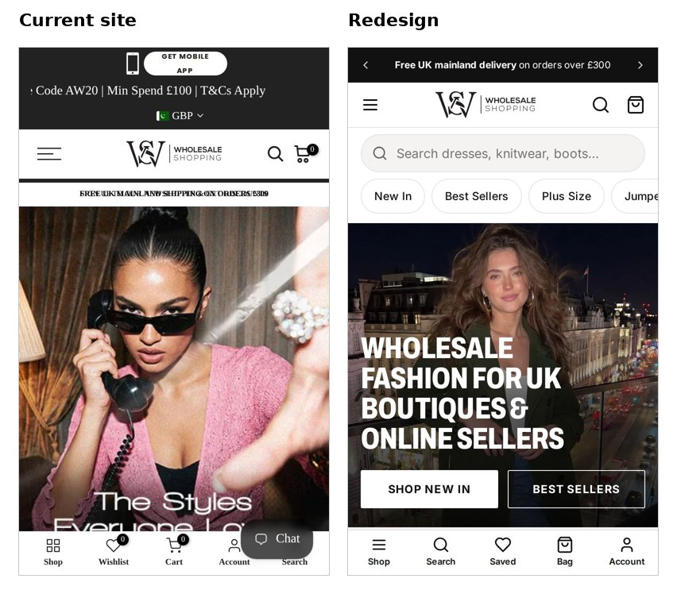
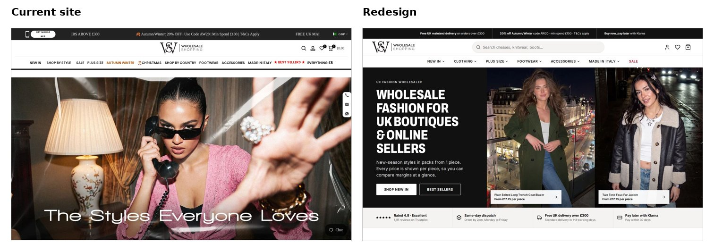
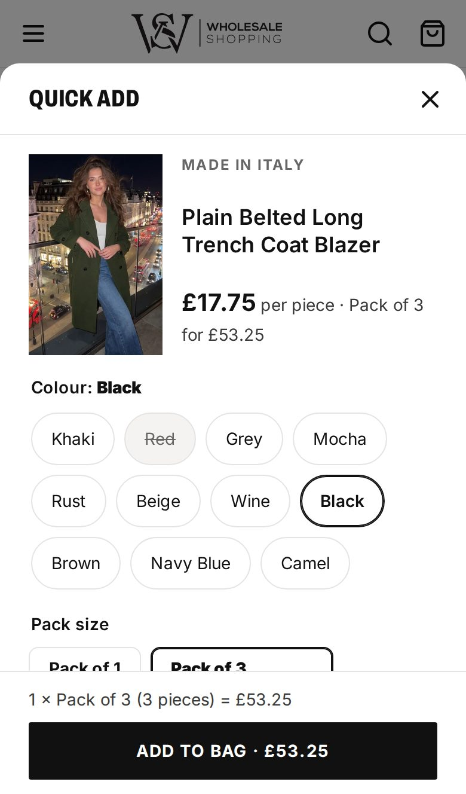
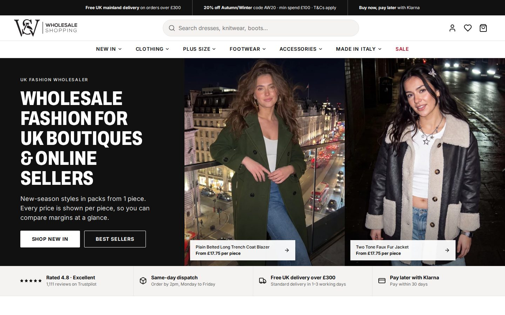

# CRO decisions: what changed from the current homepage, and why

> **Draft for you to edit.** Every "Problem" below comes from the live site, checked on 12–13 Oct 2026 (see `notes/real-facts.md` and `notes/screenshots/before/`). Delete this note before submitting.

The brief's question was: *what would make a fashion retailer arriving on this homepage more likely to browse products, find relevant stock and place an order?* Each change below answers part of it.

---

### 1. Say who it's for, above the fold
- **Problem:**
  - The hero is four picture-only slides, with the text baked into the images ("The Styles Everyone Loves") and no alt text.
  - On a phone that text is cut off, and the first screen has no button and no product.
  - The page's only main heading (H1) sits in a block of SEO text near the bottom.
- **Change:**
  - The hero has real text that says who the site is for: *"Wholesale fashion for UK boutiques & online sellers"*. This is now the H1.
  - A one-line pitch and two buttons, **Shop New In** and **Best Sellers**.
  - On phones both buttons fit on the first screen above the bottom bar (tested at 360 and 390 px wide).
- **Expected benefit:** trade buyers know in seconds they're in the right place, and there's an obvious next step, so fewer leave straight away. Search engines and screen readers can now read the message too.

### 2. Fewer, clearer menu choices
- **Problem:** 12 top menu items mix categories, seasons and offers, in three different text styles.
- **Change:**
  - **7 items:** New In, Clothing, Plus Size, Footwear, Accessories, Made in Italy, Sale.
  - Each has a mega menu that keeps all of the store's real categories, grouped by category, style, country and pack price.
  - On phones: a menu drawer with department tabs, plus one-tap chips under the search box (New In, Best Sellers, Plus Size, Jumpers…).
- **Expected benefit:** faster scanning and fewer wrong clicks. Phone buyers reach their category in one tap.

### 3. One clear offer bar instead of competing promotions
- **Problem:**
  - The top of the page stacks an app button, a scrolling AW20 ticker, a currency selector, and a strip alternating "free delivery" and "newsletter" messages (on a phone the two overlapped in our screenshot).
  - A Klarna ticker sits further down, and free delivery is announced twice.
- **Change:**
  - **One offer bar** with three real offers: free UK delivery over £300, 20% off Autumn/Winter with AW20, and pay later with Klarna.
  - Desktop shows all three. Phones rotate them slowly, pause on touch, and stop for visitors who switch off motion.
  - Seasonal offers become two photo banners with live text.
- **Expected benefit:** offers get noticed and understood, and there's less noise competing with the products.

### 4. Show prices the way resellers compare them
- **Problem:**
  - Product cards show confusing ranges such as *"£29.25 – £29.25 (Pack of 3 – Pack of 3)"*.
  - The "Under £4.99 … £19.99" collections filter by **pack** price, but nothing says so.
  - VAT isn't mentioned on the storefront, although the T&Cs say prices exclude VAT.
- **Change:**
  - Cards lead with the **price per piece** ("From £17.75 per piece"), then the pack ("Pack of 3 · £53.25"), the number of colours, and badges (New, Made in Italy, Plus Size).
  - Price tiles say **"Packs under £X"**.
  - "Prices per piece, excluding VAT" appears by the product row and in the bag.
- **Expected benefit:** buyers can compare margins at a glance and trust the numbers. More product views turn into adds.

### 5. More products, sooner
- **Problem:** the homepage shows only 4 "Autumn Picks" and 20 footwear products. There's no New In or Best Sellers row, and no product on the first screen.
- **Change:**
  - Category tiles with real product photos.
  - A tabbed **"Shop the latest"** row: New In, Best Sellers, Plus Size, Footwear and Made in Italy, 12 products each, swipeable on phones.
  - Search shows matching products as you type.
- **Expected benefit:** more products seen per visit, and buyers find relevant stock without leaving the homepage.

### 6. Add to the bag from the homepage (Quick Add)
- **Problem:** every product means opening its page, choosing colour and pack there, and coming back.
- **Change:**
  - **Quick Add** on every card: choose colour, pack size and number of packs in a bottom sheet on phones or a window on desktop.
  - It opens on the best-value pack in stock and shows the total.
  - On phones the Add button stays pinned at the bottom.
- **Expected benefit:** much faster ordering of many products, which is how wholesale buyers shop, so more items end up in each order.

### 7. No surprises at checkout: the £100 minimum and £300 free delivery
- **Problem:**
  - The store blocks checkout under £100, but only says so on the cart page.
  - Nothing encourages buyers towards free delivery at £300; below that it costs £9.99–£12.99.
- **Change:**
  - The bag shows a progress bar with two milestones, £100 minimum and £300 free delivery. The message changes as the bag grows: *"Add £46.75 to reach the £100 minimum order"* → *"Add £X for free UK delivery"* → *"Free UK delivery unlocked"*.
  - Checkout hands the bag to the store's real Shopify checkout.
- **Expected benefit:** fewer abandoned checkouts at the minimum, and bigger orders as buyers top up towards £300.

### 8. Put trust where the decision is made
- **Problem:**
  - Trustpilot appears only in the footer, and the site quotes different review numbers (178 in its structured data, "1,300+" elsewhere).
  - Same-day dispatch, a strong benefit for traders, isn't on the homepage.
  - On phones the chat bubble covers the Search button.
- **Change:**
  - **A trust strip right under the hero:**
    - Trustpilot 4.8 "Excellent" from 1,111 reviews
    - same-day dispatch for orders placed by 2pm, Monday to Friday
    - free UK delivery over £300
    - pay later with Klarna within 30 days
  - Real review quotes further down.
  - A four-step **"How wholesale ordering works"** section: register → choose packs → check out from £100 → same-day dispatch.
  - A bottom bar that nothing covers.
- **Expected benefit:** first-time trade buyers feel safe enough to place a first order.

---

### Also improved
- **Accessibility:** Lighthouse accessibility 100, every control at least 44 px tall on phones, menus that work with a keyboard, and no animation for visitors who switch motion off.
- **Speed:** Lighthouse performance 91 on phones and 92 on desktop, with no layout shift, and about 9 KB of JavaScript.

### How I'd prove it
I'd A/B test the new homepage against the current one, tracking:
- clicks on the hero buttons
- product views per visit
- Quick Add → add-to-bag rate
- checkout starts
- average order value and the share of orders over £300
