# Homepage walkthrough: each section and the part of the brief it meets

> **Draft for you to edit.** Screenshots come from the live site (`scripts/walkthrough-screenshots.mjs`). Requirements in quotes are the brief's own words. Delete this note before sharing.

**Live link:** https://wholesaleshopping-homepage-redesign.netlify.app

**How to read each section:**
- **What it does:** what the section shows and how it behaves.
- **Meets the brief:** the brief's own words it covers, with the part of the brief they come from (What We Want to See, CRO Thinking, Mobile Matters, Test Your Work).
- **Fashion Nova idea:** the pattern borrowed from Fashion Nova, and how it was adapted for trade buyers.

A table at the end lists every requirement and the sections that cover it.

<section class="step">

## 1. First screen: before and after

**What changed:**
- **Before:** the first screen is a picture-only slide with its text baked into the image ("The Styles Everyone Loves"), and there's no button and no product.
- **After:**
  - The first screen says who the site is for, with two clear buttons and the facts trade buyers check: rating, dispatch, delivery and payment.
  - On phones it also has the search box and one-tap category chips, and both buttons stay above the bottom bar.

**Meets the brief:**
- *"Redesign the homepage … with a stronger focus on modern e-commerce design, user experience, mobile usability and conversion"* (The Challenge)
- *"What information should appear above the fold"* (CRO Thinking)
- *"How quickly shoppers can reach products"* (Mobile Matters)

</section>

<section class="step">

## 2. Offer bar and header

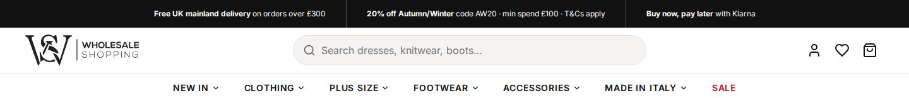

**What it does:**
- **Offer bar:** one bar with three real offers: free UK mainland delivery over £300, 20% off Autumn/Winter with code AW20, and pay later with Klarna. Desktop shows all three; phones rotate them slowly and pause on touch.
- **Header:** the store's logo, a wide search box, account, saved items and the bag (with counts).
- **Menu:** seven clear items instead of twelve mixed ones.

**Meets the brief:**
- *"Promotional areas"* (What We Want to See)
- *"Clear navigation and product discovery"* (What We Want to See)
- *"How promotions are communicated"* (CRO Thinking)
- *"Visual hierarchy and spacing"* (What We Want to See)

**Fashion Nova idea:** the black offer bar and the big search box. They're adapted without Fashion Nova's countdown timer: it shows real trade offers only, because fake urgency hurts trust with business buyers.

</section>

<section class="step">

## 3. Menus: mega menu (desktop), menu drawer and bottom bar (phone)

<figure>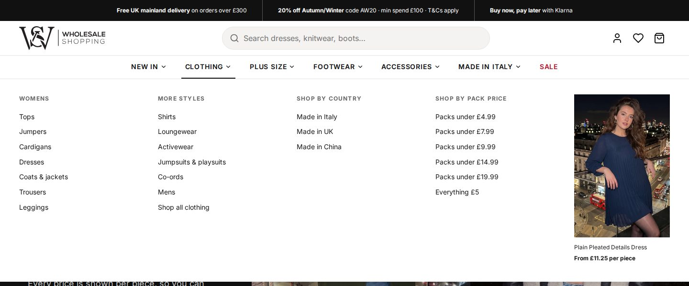<figcaption>Desktop</figcaption></figure>
<figure>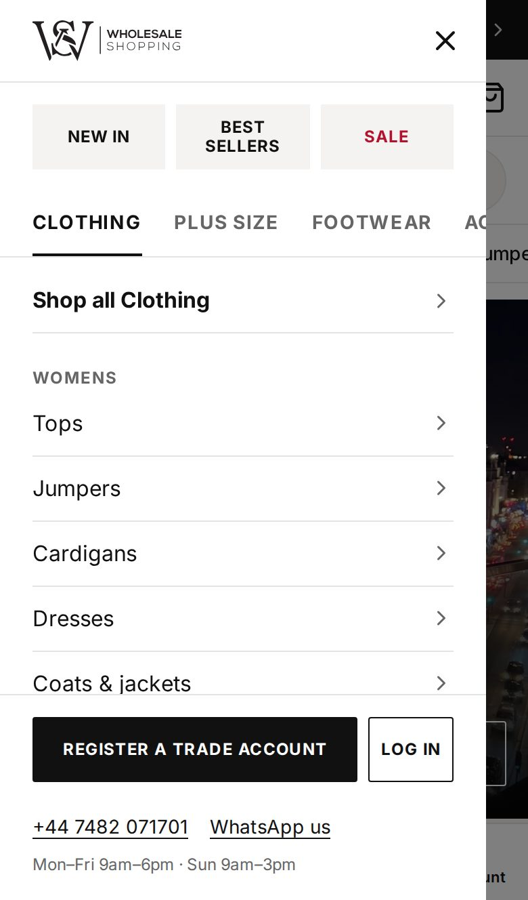<figcaption>Phone</figcaption></figure>

**What it does:**
- **Mega menus:** they keep all of the store's real categories, grouped by category, style, country and pack price, with a featured product. They open on hover, click or keyboard, and close with Esc.
- **Phone menu:** a drawer with department tabs, big rows, "Register a trade account" and the contact details.
- **Bottom bar:** puts Shop, Search, Saved, Bag and Account within thumb reach.

**Meets the brief:**
- *"Clear navigation and product discovery"* (What We Want to See)
- *"How quickly users can reach collections"* (CRO Thinking)
- *"Mobile navigation"*, *"button sizes"* (Mobile Matters): every control is at least 44 px tall.
- *"Navigation works"* (Test Your Work): tested at four screen sizes.

**Fashion Nova idea:** the department tabs in Fashion Nova's mobile menu.

</section>

<section class="step">

## 4. Hero

<figure>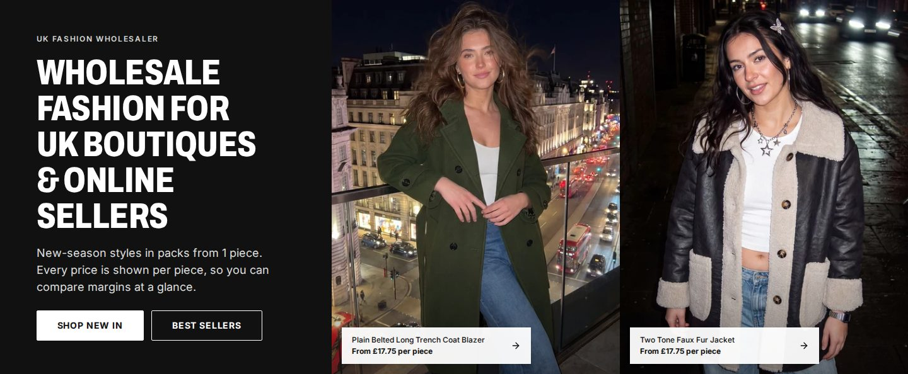<figcaption>Desktop</figcaption></figure>
<figure><figcaption>Phone (first screen)</figcaption></figure>

**What it does:**
- **Headline:** "Wholesale fashion for UK boutiques & online sellers", in real text. It's the page's main heading, so search engines and screen readers can read it too.
- **Buttons:** **Shop New In** and **Best Sellers**.
- **Photos:** real New In products. On desktop each has a "shop this look" tag with its price per piece.
- **On phones:** the photo is cropped for the phone, the text sits over a dark gradient, and both buttons stay on the first screen.

**Meets the brief:**
- *"Strong hero/banner area"*, *"Clear calls to action"*, *"B2B wholesale messaging"* (What We Want to See)
- *"Where important CTAs appear"*, *"what information should appear above the fold"* (CRO Thinking)
- *"Banner proportions"*, *"button sizes"* (Mobile Matters)
- *"You may use existing Wholesale Shopping product and banner images"*: these are the store's own product photos.

**Fashion Nova idea:** the full-width campaign photo. Fashion Nova bakes its message into the image; here the message is live text.

</section>

<section class="step">

## 5. Search

<figure>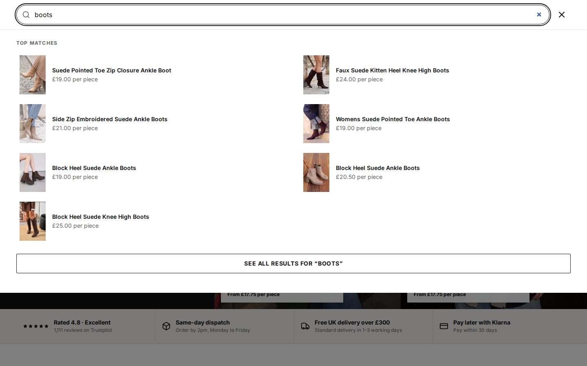<figcaption>Desktop</figcaption></figure>
<figure>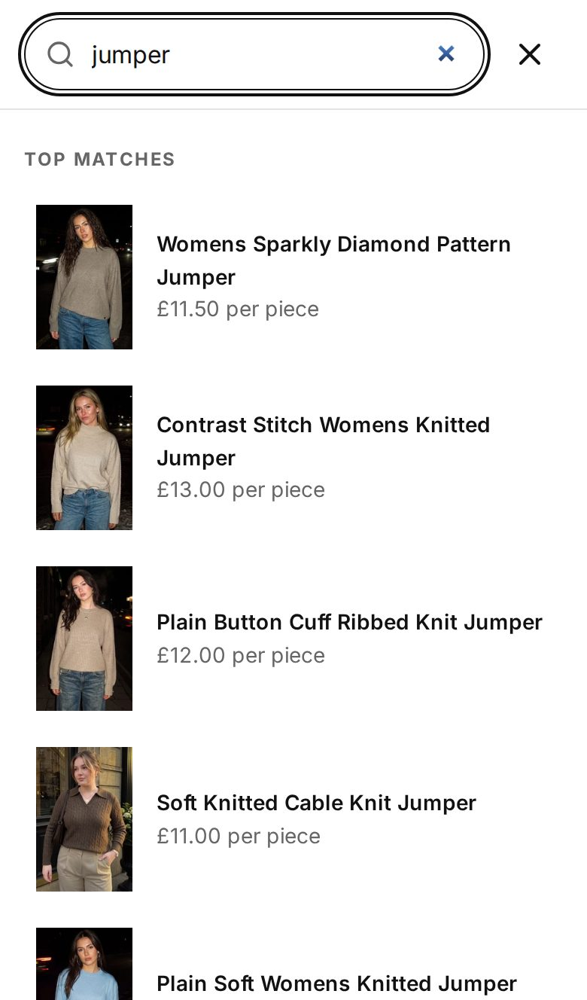<figcaption>Phone</figcaption></figure>

**What it does:**
- Matching products appear while you type, each with a photo and price per piece.
- Popular searches show before you type.
- "See all results" and Enter hand over to the store's full search.

**Meets the brief:**
- *"Clear navigation and product discovery"*, *"A smoother path from homepage to product discovery and purchase"* (What We Want to See)

**Fashion Nova idea:** the large search bar at the top of every page.

</section>

<section class="step">

## 6. Trust strip

<figure>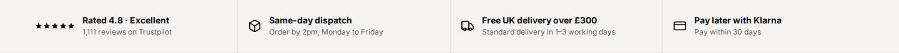<figcaption>Desktop</figcaption></figure>
<figure>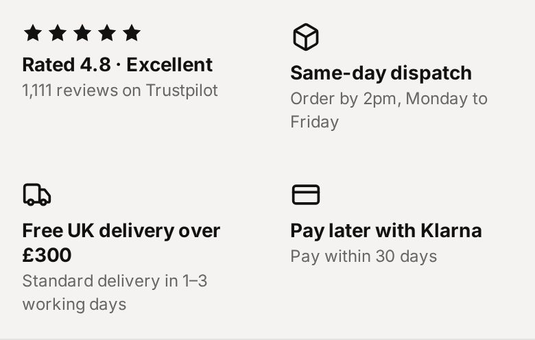<figcaption>Phone</figcaption></figure>

**What it does:** right under the hero, it shows the facts a first-time trade buyer checks:
- Trustpilot **4.8 "Excellent" from 1,111 reviews**
- **same-day dispatch** for orders placed by 2pm, Monday to Friday
- **free UK delivery over £300**
- **pay later with Klarna** within 30 days

On phones it's a 2 × 2 grid, so everything is visible without swiping. Before, this information was only in the footer.

**Meets the brief:**
- *"Trust and credibility"*, *"B2B wholesale messaging"* (What We Want to See)
- *"What information should appear above the fold"* (CRO Thinking)

</section>

<section class="step">

## 7. Shop by category

<figure>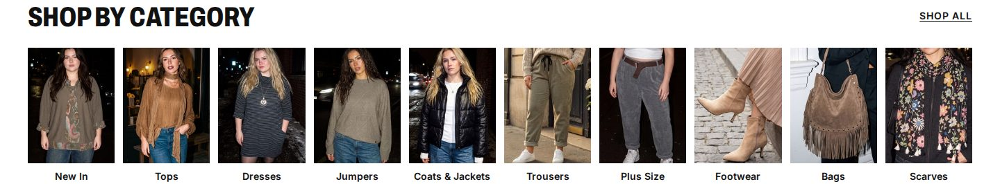<figcaption>Desktop</figcaption></figure>
<figure>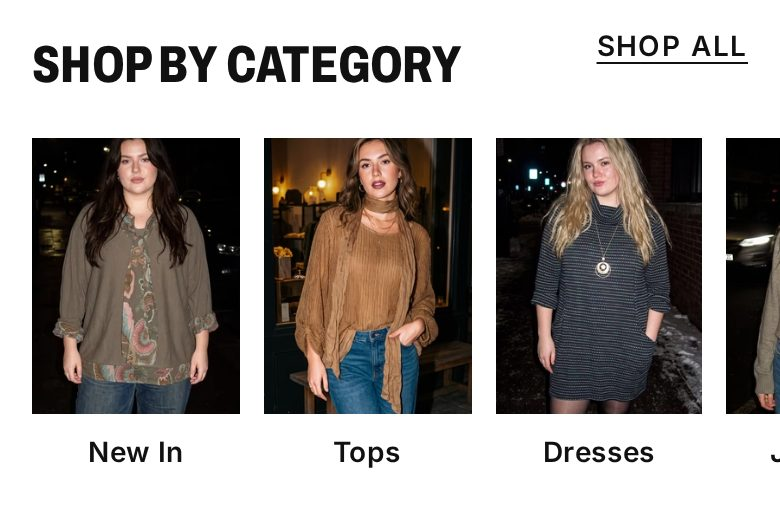<figcaption>Phone</figcaption></figure>

**What it does:**
- **Ten photo tiles:** New In, Tops, Dresses, Jumpers, Coats & Jackets, Trousers, Plus Size, Footwear, Bags and Scarves, each showing one of that collection's own product photos.
- **Phones:** the tiles become a swipe row, with the next tile peeking in so buyers can see the row scrolls.

**Meets the brief:**
- *"New arrivals and key collections"*, *"Clear navigation and product discovery"* (What We Want to See)
- *"How quickly users can reach collections"* (CRO Thinking)
- *"Scrolling behaviour"* (Mobile Matters)

**Fashion Nova idea:** "Shop by Category" tiles.

</section>

<section class="step">

## 8. Shop the latest: product row and wholesale product card

<figure>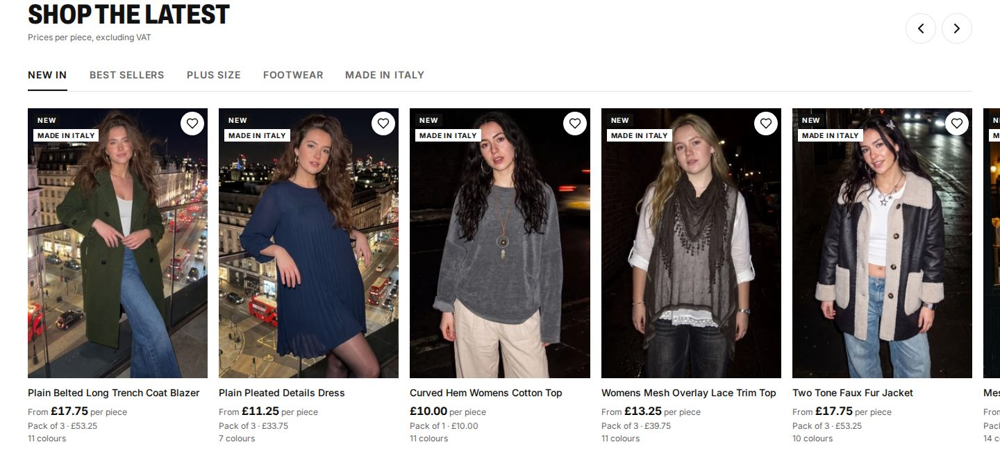<figcaption>Desktop</figcaption></figure>
<figure>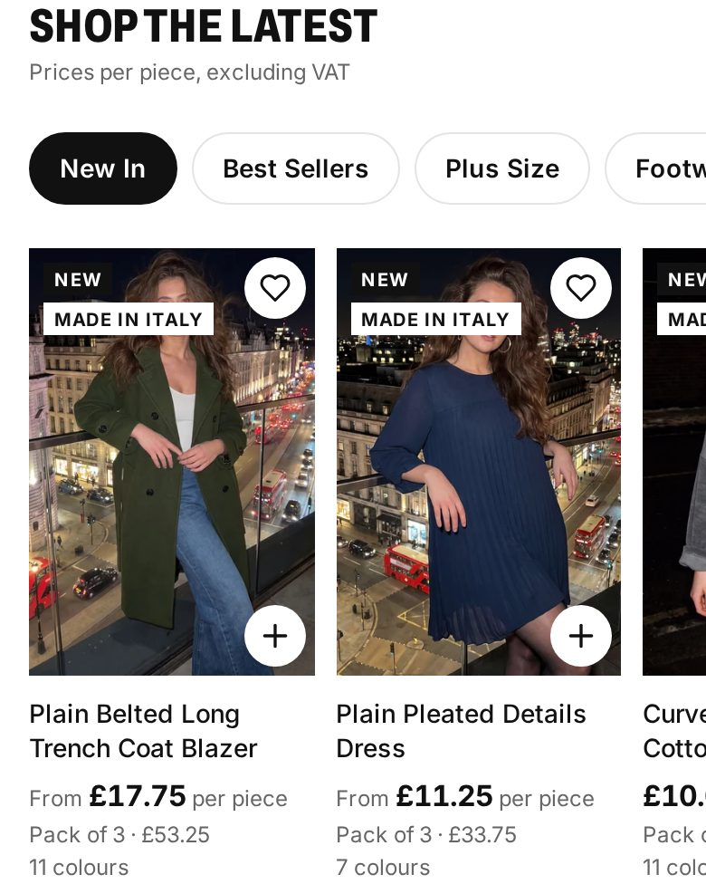<figcaption>Phone</figcaption></figure>

**What it does:**
- **Five tabs:** New In, Best Sellers, Plus Size, Footwear and Made in Italy, with 12 real products each.
- **The wholesale product card** shows:
  - **the price per piece first** ("From £17.75 per piece"), then the pack and its price
  - the number of colours, and badges (New, Made in Italy, Plus Size)
  - a save heart and a **Quick Add** button
- A note next to the row says prices are per piece and exclude VAT.

**Meets the brief:**
- *"Product sections"*, *"New arrivals and key collections"*, *"B2B wholesale messaging"* (What We Want to See)
- *"Product cards"* (Mobile Matters)
- *"Product cards are usable"* (Test Your Work)

**Fashion Nova idea:** "Shop the Latest" tabs and Quick Add. The card is reworked for resellers, who compare the cost per piece.

</section>

<section class="step">

## 9. Quick Add

<figure>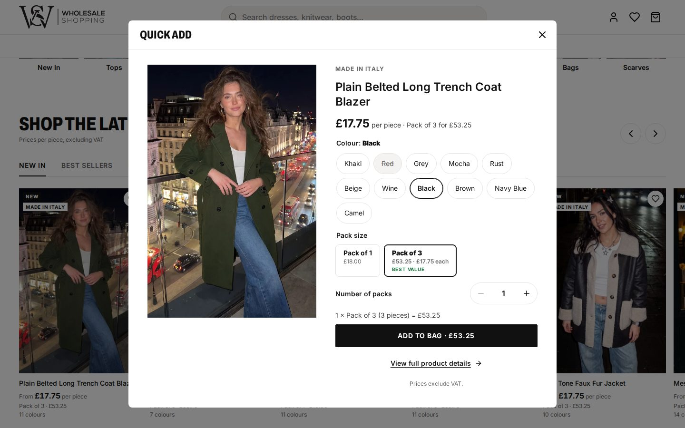<figcaption>Desktop</figcaption></figure>
<figure>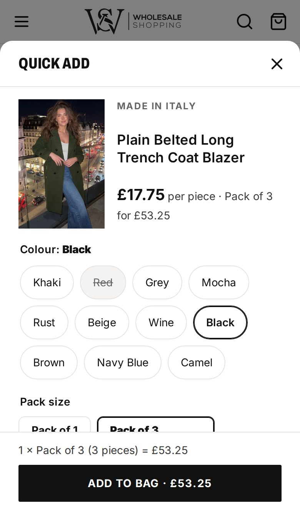<figcaption>Phone</figcaption></figure>

**What it does:**
- Buyers choose colour, pack size and number of packs **without leaving the homepage**.
- It opens on the best-value pack in stock, marked "Best value", and sold-out colours are struck through.
- The total updates live.
- On phones it's a bottom sheet, with the Add to bag button pinned at the bottom.

**Meets the brief:**
- *"A smoother path from homepage to product discovery and purchase"*, *"Purposeful animations or interactions where appropriate"* (What We Want to See)
- *"Your homepage should feel like a real e-commerce experience rather than just a visual mock-up"* (What We Want to See)
- *"Button sizes"* (Mobile Matters)

</section>

<section class="step">

## 10. Bag: £100 minimum order and £300 free delivery

<figure>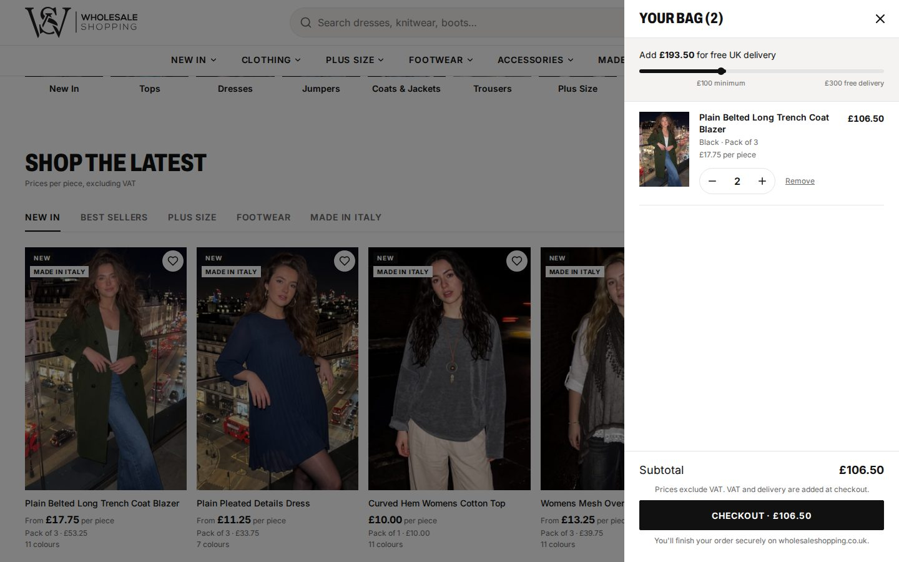<figcaption>Desktop: over £100</figcaption></figure>
<figure>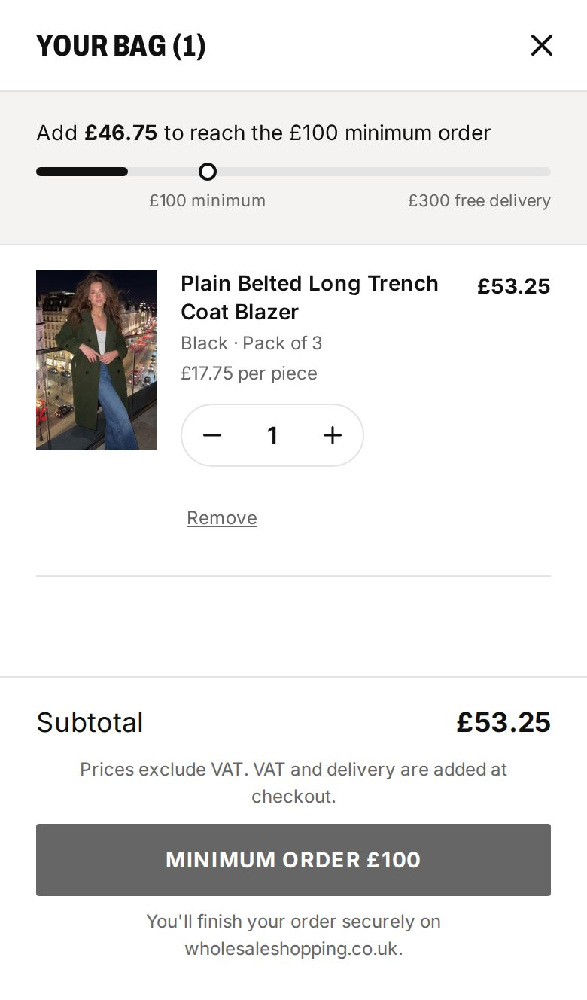<figcaption>Phone: under £100</figcaption></figure>

**What it does:**
- **Progress bar:** shows the store's real rules, the **£100 minimum order** and **£300 free UK delivery**.
  - Below £100 it says how much more is needed, and checkout stays disabled.
  - Above £100 it says how far it is to free delivery.
- **VAT:** a note says prices exclude VAT.
- **Checkout:** hands the bag to the store's real Shopify checkout.

**Meets the brief:**
- *"Think about the complete buying journey"*, *"Clear calls to action"*, *"B2B wholesale messaging"* (What We Want to See)
- *"More likely to … place an order"* (CRO Thinking)

**Fashion Nova idea:** "You're $X away from free shipping". The wholesale version adds the minimum order, so there are no surprises at checkout.

</section>

<section class="step">

## 11. Shop by pack price

<figure>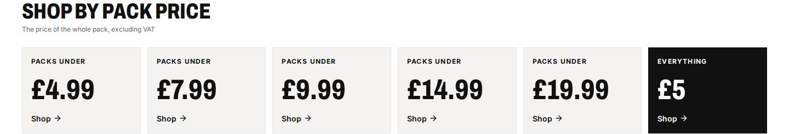<figcaption>Desktop</figcaption></figure>
<figure>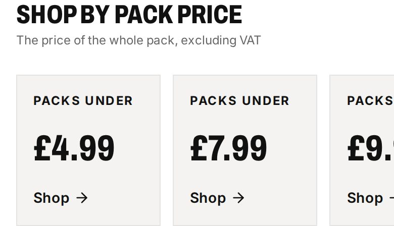<figcaption>Phone</figcaption></figure>

**What it does:**
- Tiles for "Packs under £4.99 / £7.99 / £9.99 / £14.99 / £19.99" and "Everything £5", each linking to the store's real collection.
- They say "pack" because those collections filter by the price of the whole pack, which keeps the labels accurate next to the per-piece prices on the cards.

**Meets the brief:**
- *"Promotional areas"*, *"Clear navigation and product discovery"*, *"B2B wholesale messaging"* (What We Want to See)

</section>

<section class="step">

## 12. Seasonal banners

<figure>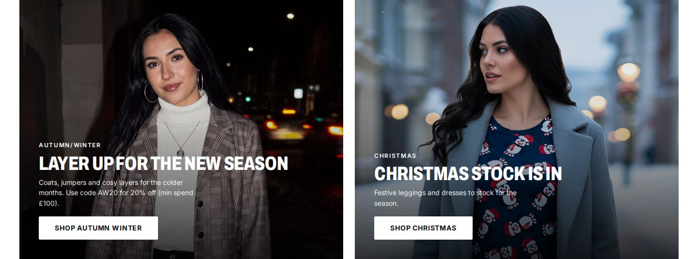<figcaption>Desktop</figcaption></figure>
<figure>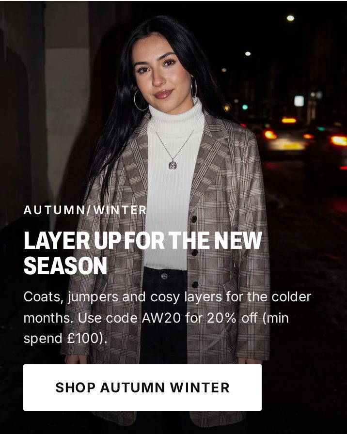<figcaption>Phone</figcaption></figure>

**What it does:**
- Two banners: Autumn/Winter (with the AW20 code) and Christmas.
- Live text over real product photos, and the whole banner is one tap target.
- Landscape on desktop, portrait on phones.

**Meets the brief:**
- *"Promotional areas"*, *"Strong hero/banner area"* (What We Want to See)
- *"Banner proportions"* (Mobile Matters)

</section>

<section class="step">

## 13. How wholesale ordering works

<figure>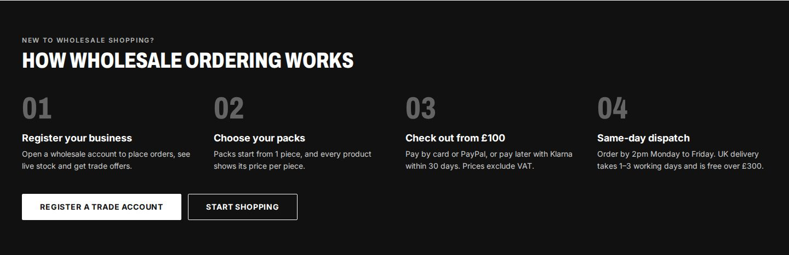<figcaption>Desktop</figcaption></figure>
<figure>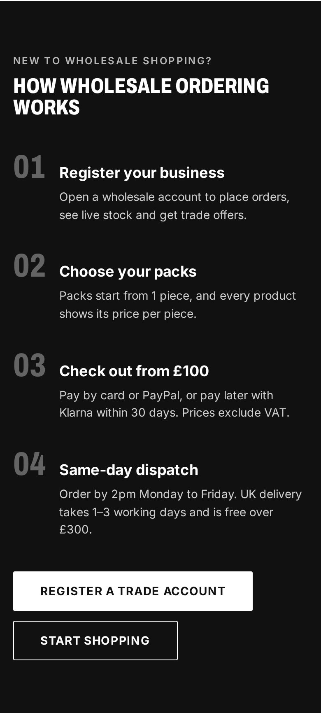<figcaption>Phone</figcaption></figure>

**What it does:** four steps for first-time trade buyers:
1. Register your business.
2. Choose your packs.
3. Check out from £100 (card, PayPal or Klarna; prices exclude VAT).
4. Same-day dispatch.

Then two buttons: **Register a trade account** and **Start shopping**.

**Meets the brief:**
- *"B2B wholesale messaging"*, *"Trust and credibility"*, *"Clear calls to action"* (What We Want to See)

</section>

<section class="step">

## 14. Reviews

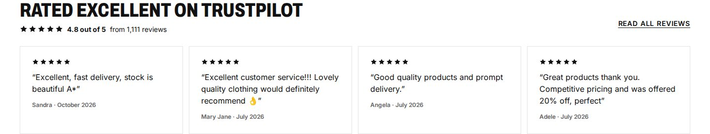

**What it does:** shows the Trustpilot rating and four recent real reviews, with a link to all of them. They swipe on phones.

**Meets the brief:**
- *"Trust and credibility"* (What We Want to See)

</section>

<section class="step">

## 15. Newsletter and app

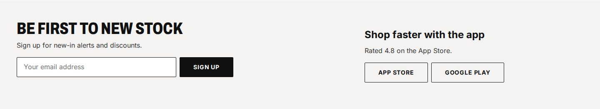

**What it does:**
- A sign-up for new-in alerts and discounts. It's a demo in this concept, so nobody is added to the real list.
- Links to the store's real App Store and Google Play listings.

**Meets the brief:**
- *"Clear calls to action"*, *"Promotional areas"* (What We Want to See)

</section>

<section class="step">

## 16. FAQ and About

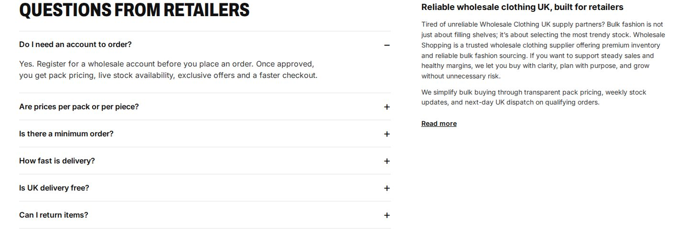

**What it does:**
- **FAQ:** six real trade questions (account, per-piece pricing, minimum order, delivery speed, free delivery, returns), opening as accordions.
- **About:** the store's long SEO text stays on the page for search engines, but folded behind "Read more" so it doesn't push products down.

**Meets the brief:**
- *"Trust and credibility"*, *"B2B wholesale messaging"*, *"Visual hierarchy and spacing"* (What We Want to See)

</section>

<section class="step">

## 17. Footer

<figure>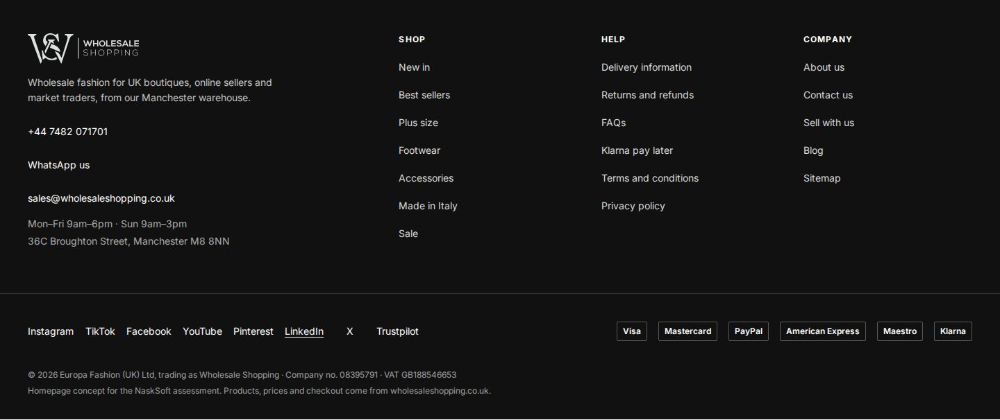<figcaption>Desktop</figcaption></figure>
<figure>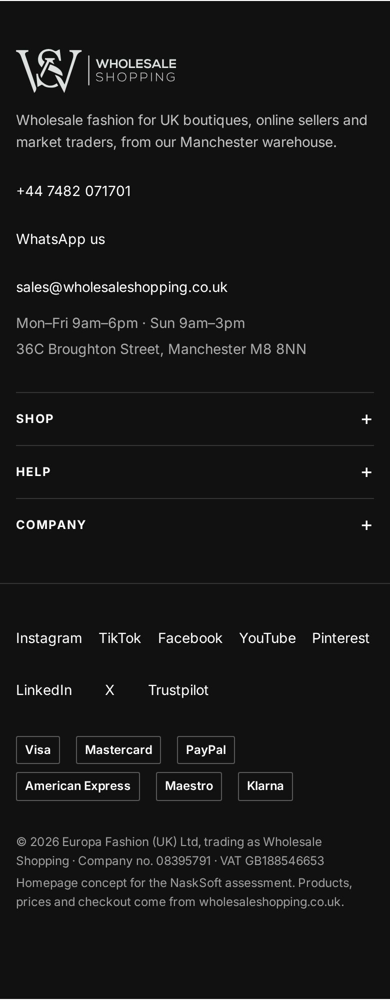<figcaption>Phone</figcaption></figure>

**What it does:**
- **Contact:** phone, WhatsApp, email, opening hours and the Manchester address.
- **Links:** Shop, Help and Company, which fold into accordions on phones.
- **Also:** social links, payment methods, and the company and VAT numbers.

**Meets the brief:**
- *"Clear navigation and product discovery"*, *"Trust and credibility"* (What We Want to See)
- *"Spacing"*, *"button sizes"* (Mobile Matters)

</section>

<section class="step">

## 18. Animations and interactions

**What it does:**
- **Movement:** sections fade in as they scroll into view, the second product photo appears on hover, and drawers and sheets slide in.
- **Bag count:** it updates instantly when packs are added.
- **Reduced motion:** all of this switches off for visitors who choose "reduce motion" on their device.
- **Auto-play:** nothing plays on its own except the offer text on phones, which pauses on touch.

**Meets the brief:**
- *"Purposeful animations or interactions where appropriate"* (What We Want to See)
- *"Animations do not interfere with usability"* (Test Your Work): an automated test checks the reduced-motion behaviour.

</section>

<section class="step">

## 19. Tested

**What was checked:**
- **55 automated tests** pass against the live link at four screen sizes: 360 px Android, 390 px iPhone, 768 px tablet and 1440 px desktop.
- **146 links** were checked against the live store; 0 broken.
- **Lighthouse on the live site:** accessibility 100 and best practices 100.
- **Problems found and fixed** are explained in the AI Build Notes.

**Meets the brief:**
- *"Navigation works"*, *"Buttons and links work"*, *"Sections behave correctly"*, *"Mobile layouts do not break"*, *"Product cards are usable"*, *"Text remains readable"*, *"Animations do not interfere with usability"*, *"The overall journey feels natural"* (Test Your Work)

</section>

<section class="step">

## The brief, item by item

| Requirement in the brief | Sections |
|---|---|
| Clear navigation and product discovery | 2, 3, 5, 7, 11, 17 |
| Strong hero/banner area | 1, 4, 12 |
| New arrivals and key collections | 7, 8 |
| Product sections | 8 |
| Promotional areas | 2, 11, 12, 15 |
| Clear calls to action | 4, 10, 13, 15 |
| Trust and credibility | 6, 13, 14, 16, 17 |
| B2B wholesale messaging | 4, 6, 8, 10, 11, 13, 16 |
| Desktop and mobile responsiveness | Every section: desktop and phone shown side by side |
| Visual hierarchy and spacing | 2, 16 |
| Purposeful animations or interactions | 9, 18 |
| A smoother path from homepage to product discovery and purchase | 5, 8, 9, 10 |
| CRO: where important CTAs appear | 4, 10 |
| CRO: how quickly users can reach collections | 3, 7 |
| CRO: how promotions are communicated | 2, 12 |
| CRO: what information should appear above the fold | 1, 4, 6 |
| CRO: how the experience changes on mobile | 1, 3, 4, 7, 9 |
| Mobile: navigation, banner proportions, readability, button sizes, product cards, spacing, scrolling, reaching products | 1, 3, 4, 7, 8, 9, 12, 17 |
| Test your work (8 checks) | 18, 19 |

</section>
